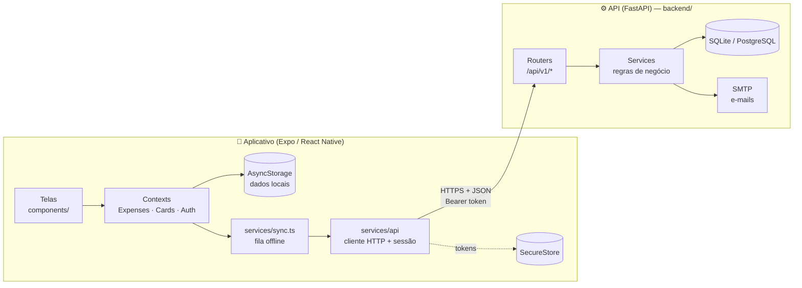

<div align="center">

# `cash`

**Controle de despesas pessoais e compartilhadas, com design minimalista e retrofuturista e foco total em simplicidade.**

Aplicativo mobile (Expo / React Native) e API (FastAPI) no mesmo repositório.

[](https://expo.dev)
[](https://reactnative.dev)
[](https://www.typescriptlang.org/)
[](https://fastapi.tiangolo.com)
[](https://www.python.org)
[](https://docs.docker.com/compose/)
[](https://expo.dev)

</div>

---

## 📑 Sumário

1. [Visão geral](#-visão-geral)
2. [Funcionalidades](#-funcionalidades)
3. [Arquitetura](#-arquitetura)
4. [Tecnologias](#-tecnologias)
5. [Estrutura do repositório](#-estrutura-do-repositório)
6. [Como rodar o projeto](#-como-rodar-o-projeto)
   - [Pré-requisitos](#pré-requisitos)
   - [1. Subir a API](#1-subir-a-api)
   - [2. Abrir o aplicativo](#2-abrir-o-aplicativo)
   - [3. Primeiro uso](#3-primeiro-uso)
7. [Variáveis de ambiente](#-variáveis-de-ambiente)
8. [Aplicativo mobile (front-end)](#-aplicativo-mobile-front-end)
   - [Telas](#telas)
   - [Estado global (Contexts)](#estado-global-contexts)
   - [Serviços](#serviços)
   - [Sincronização offline-first](#sincronização-offline-first)
   - [Despesas recorrentes](#despesas-recorrentes)
9. [API (back-end)](#-api-back-end)
   - [Autenticação](#autenticação)
   - [Formato das respostas](#formato-das-respostas)
   - [Endpoints](#endpoints)
   - [E-mails](#e-mails)
   - [Segurança](#segurança)
   - [Banco de dados e migrações](#banco-de-dados-e-migrações)
10. [Modelos de dados](#-modelos-de-dados)
11. [Testes e qualidade](#-testes-e-qualidade)
12. [Scripts e comandos](#-scripts-e-comandos)
13. [Build e distribuição (EAS)](#-build-e-distribuição-eas)
14. [Solução de problemas](#-solução-de-problemas)
15. [Documentação complementar](#-documentação-complementar)
16. [Integrantes do grupo](#-integrantes-do-grupo)
17. [Licença e créditos](#-licença-e-créditos)

---

## 💡 Visão geral

O **CASH** é um aplicativo para registrar despesas do dia a dia, dividir contas entre pessoas e acompanhar o limite dos cartões. Ele foi pensado para ser rápido e sem atrito: abre e funciona na hora, mesmo sem internet e sem conta.

O visual se inspira na estética retrofuturista e minimalista do **Nothing OS**, com a tipografia matricial `Ndot57`, fundo preto OLED e uma cor de destaque que o usuário escolhe.

O projeto tem duas partes que trabalham juntas:

| Parte | Pasta | O que faz |
| :--- | :--- | :--- |
| **Aplicativo** | `/` (raiz) | App Expo / React Native para Android, iOS e Web. Guarda tudo no aparelho e funciona offline. |
| **API** | [`backend/`](backend/) | FastAPI + SQLAlchemy. Contas, sincronização entre aparelhos, recuperação de senha, estatísticas e backup na nuvem. |

> A conta é **opcional**. Sem login, os dados ficam só no aparelho. Com login, cada alteração é enviada para a API e aparece nos outros aparelhos da mesma conta.

---

## ✨ Funcionalidades

### Aplicativo

- 🔒 **Offline-first**: tudo é salvo no aparelho (`AsyncStorage`) e o app funciona sem internet.
- ☁️ **Sincronização opcional**: com uma conta, as despesas e os cartões são sincronizados com a API e entre aparelhos.
- 👤 **Conta e acesso**: cadastro, login, recuperação de senha por código de 6 dígitos e desbloqueio por biometria (Android).
- 💳 **Carteira de cartões**: cartões de crédito e débito com limite, gasto, pendente, pago e disponível.
- 🧾 **Despesas completas**: pessoa responsável, tags, cartão, status pago/pendente e busca com filtros.
- 🔁 **Despesas recorrentes**: repete uma despesa pelos próximos meses, com opção de pular meses específicos.
- 📅 **Calendário**: visão mensal com totais por dia e marcadores de pendente/pago.
- 📊 **Análises**: totais por pessoa, por tag e tendência dos últimos 6 meses.
- 💾 **Backup e restauração**: exporta e importa todos os dados em JSON.
- 🎨 **Personalização**: modo claro/escuro, cor de destaque e idioma (inglês ou português).
- 🧭 **Tutorial de introdução**: onboarding na primeira abertura, que pode ser revisto nas Configurações.

### API

- 🔑 **Autenticação multi-dispositivo**: `accessToken` JWT + `refreshToken` com rotação e revogação por aparelho.
- 🔄 **Sincronização em lote** (`POST /sync/batch`) com resolução de conflitos *Last-Write-Wins*.
- 📬 **E-mails**: recuperação de senha, verificação de e-mail, lembretes semanais e relatório mensal.
- 👥 **Grupos**: despesas compartilhadas (casal, república, viagem) com saldo por pessoa.
- 📈 **Dashboard e estatísticas** prontos para as telas do app.
- 🛡️ **Camada de segurança**: rate limit, limite de tamanho de corpo, cabeçalhos de segurança, assinatura HMAC opcional e versão mínima do app.
- 🐳 **Docker**: imagem multi-stage, sem root, com healthcheck e volume persistente.
- 📖 **Documentação interativa** (Swagger) em `/docs`.

---

## 🏛️ Arquitetura



**Como os dados circulam:**

1. A tela altera uma despesa ou um cartão por meio do Context correspondente.
2. O Context salva no aparelho na hora (o app nunca espera a rede) e registra a alteração na **fila de sincronização**.
3. Se houver conta logada e internet, a fila é enviada em lote para `POST /api/v1/sync/batch`.
4. A resposta traz o que mudou em outros aparelhos desde o último envio, e isso é aplicado nos Contexts.
5. Sem internet, a fila fica guardada e é reenviada quando a conexão volta ou quando o app é reaberto.

---

## 🧰 Tecnologias

| Camada | Tecnologias |
| :--- | :--- |
| **App** | Expo SDK 58, React Native 0.88, React 19, TypeScript 6, Expo Router, React Navigation, Reanimated, Gesture Handler, PagerView |
| **Armazenamento no app** | `@react-native-async-storage/async-storage` (dados), `expo-secure-store` (tokens) |
| **Recursos nativos** | `expo-local-authentication` (biometria), `expo-haptics`, `@react-native-community/datetimepicker`, `expo-linear-gradient` |
| **API** | Python 3.12, FastAPI 0.141, Pydantic v2, SQLAlchemy 2, Alembic, Uvicorn |
| **Segurança da API** | `python-jose` (JWT), `pwdlib[argon2]` (hash de senha), `email-validator` |
| **Banco de dados** | SQLite (padrão, desenvolvimento) ou PostgreSQL (produção) |
| **Infraestrutura** | Docker (multi-stage) e Docker Compose |
| **Qualidade** | pytest, ESLint (`eslint-config-expo`), checagem de tipos com `tsc` |
| **Build mobile** | EAS Build |

---

## 📁 Estrutura do repositório

```text
cash/
├── app/                          # Rotas do Expo Router
│   ├── _layout.tsx               # Layout raiz: providers, fontes, onboarding e login
│   └── (tabs)/                   # As 4 abas principais
│       ├── index.tsx             #   Home (carteira e cartões)
│       ├── transactions.tsx      #   Transações (lista + calendário)
│       ├── statistics.tsx        #   Análises
│       └── settings.tsx          #   Configurações
│
├── components/
│   ├── auth/AuthScreen.tsx       # Login, cadastro e recuperação de senha
│   ├── onboarding/               # Tutorial de introdução
│   ├── cards/                    # Carrossel, item de cartão e modal de novo cartão
│   ├── dashboard/                # MetricCard
│   ├── screens/                  # Home, Transações, Calendário, Análises, Configurações, adicionar/editar despesa
│   └── ui/                       # FAB, BottomSheet, alertas, toggles, textos e inputs
│
├── contexts/                     # Estado global (Context API)
│   ├── AuthContext.tsx           #   Sessão, login, biometria e início da sincronização
│   ├── ExpensesContext.tsx       #   Despesas e recorrências
│   ├── CardsContext.tsx          #   Cartões
│   ├── ThemeContext.tsx          #   Tema claro/escuro e cor de destaque
│   ├── LanguageContext.tsx       #   Idioma (en / pt)
│   ├── OnboardingContext.tsx     #   Estado do tutorial
│   └── AlertContext.tsx          #   Alertas no estilo do app
│
├── services/
│   ├── api/                      # Integração com a API
│   │   ├── client.ts             #   HTTP, envelope de resposta, erros e assinatura
│   │   ├── session.ts            #   Tokens no SecureStore e renovação automática
│   │   ├── mappers.ts            #   Conversão app ⇄ API (datas, nulos, tipo de cartão)
│   │   ├── signing.ts            #   Assinatura HMAC das requisições (opcional)
│   │   └── index.ts              #   Cliente da API: auth, sync, expenses, cards
│   ├── sync.ts                   # Fila offline e sincronização via /sync/batch
│   ├── auth.ts                   # Cadastro, login, logout e recuperação de senha
│   ├── storage.ts                # Acesso tipado ao AsyncStorage
│   ├── backup.ts                 # Exportar e importar JSON
│   └── biometrics.ts             # Desbloqueio por biometria
│
├── i18n/                         # Traduções (inglês padrão + português)
├── types/index.ts                # Tipos de domínio: Expense, CreditCard, BackupData
├── utils/                        # Formatadores e geração de despesas recorrentes
├── hooks/                        # Carregamento de fontes
├── assets/                       # Fontes Ndot57 e ícones
├── docs/                         # Arquitetura, design system e especificação da API
├── theme.ts                      # Tokens de design (cores, fontes, espaçamentos)
├── app.json / eas.json           # Configuração do Expo e do EAS Build
├── .env.example                  # Variáveis do app (URL da API)
│
└── backend/                      # API do CASH
    ├── app/
    │   ├── core/                 #   Configuração, banco, JWT, segurança e serialização
    │   ├── models/               #   Tabelas SQLAlchemy
    │   ├── schemas/              #   Contratos Pydantic (camelCase)
    │   ├── routers/              #   Rotas HTTP
    │   ├── services/             #   Regras de negócio
    │   └── main.py               #   Aplicação FastAPI
    ├── migrations/               #   Alembic (0001 → 0004)
    ├── tests/                    #   Testes de API e testes unitários (tests/unit)
    ├── Dockerfile
    ├── docker-compose.yml
    ├── requirements.txt
    ├── .env.example              #   Variáveis da API
    └── README.md                 #   Documentação detalhada da API
```

---

## 🚀 Como rodar o projeto

### Pré-requisitos

| Ferramenta | Para quê |
| :--- | :--- |
| [Node.js](https://nodejs.org/) 20+ e npm | Rodar o aplicativo |
| [Docker Desktop](https://www.docker.com/products/docker-desktop/) | Rodar a API (recomendado) |
| *ou* [Python](https://www.python.org/) 3.12+ | Rodar a API sem Docker |
| [Expo Go](https://expo.dev/go), emulador Android ou simulador iOS | Abrir o app |
| [Git](https://git-scm.com/) | Clonar o repositório |

### 1. Subir a API

```bash
git clone https://github.com/yanjuca/Cashya.git cash
cd cash/backend
cp .env.example .env              # Windows PowerShell: Copy-Item .env.example .env
docker compose up -d --build
```

Pronto: a API está em **http://localhost:8000**.

| Endereço | O que é |
| :--- | :--- |
| <http://localhost:8000/api/v1/health> | Health check (responde `{"status": "ok", ...}`) |
| <http://localhost:8000/docs> | Documentação interativa (Swagger) |
| <http://localhost:8000/redoc> | Documentação em ReDoc |

Comandos úteis:

```bash
docker compose logs -f api        # acompanhar os logs (os códigos de e-mail aparecem aqui)
docker compose down               # parar (os dados continuam no volume)
docker compose down -v            # parar e apagar o banco
```

<details>
<summary><b>Rodar a API sem Docker (Python)</b></summary>

```bash
cd backend
python -m venv .venv

# Windows PowerShell
.\.venv\Scripts\Activate.ps1
# Linux / macOS
source .venv/bin/activate

pip install -r requirements.txt
cp .env.example .env              # Windows: Copy-Item .env.example .env
uvicorn app.main:app --host 0.0.0.0 --port 8000 --reload
```

As tabelas são criadas automaticamente na primeira execução. Para aplicar as migrações manualmente: `alembic upgrade head`.
</details>

### 2. Abrir o aplicativo

Em outro terminal, na **raiz** do repositório:

```bash
npm install
npx expo start
```

No terminal do Expo:

| Tecla / ação | Onde abre |
| :--- | :--- |
| <kbd>a</kbd> | Emulador Android |
| <kbd>i</kbd> | Simulador iOS (somente macOS) |
| <kbd>w</kbd> | Navegador |
| Ler o QR Code com o Expo Go | Celular físico |

**O app encontra a API sozinho** no emulador Android (`10.0.2.2:8000`), no simulador iOS e na Web (`127.0.0.1:8000`).

**No celular físico**, o `localhost` é o próprio celular. Crie o arquivo `.env.local` na raiz a partir do `.env.example` e coloque o IP do seu computador na rede:

```bash
EXPO_PUBLIC_API_URL=http://192.168.0.10:8000
```

Celular e computador precisam estar no mesmo Wi-Fi, e a porta 8000 precisa estar liberada no firewall. Depois de alterar o arquivo, reinicie o `npx expo start`.

> 💡 Para descobrir o IP: `ipconfig` no Windows (campo "Endereço IPv4") ou `ip addr` / `ifconfig` no Linux e macOS.

### 3. Primeiro uso

1. Na primeira abertura aparece o **tutorial**. Avance ou pule.
2. Na tela de acesso, **crie uma conta** para testar a sincronização, ou toque em **Continue Without an Account** para usar só no aparelho.
3. Adicione um cartão em **Settings → My Cards → New Card**.
4. Toque no botão **(+)** para registrar uma despesa (experimente ativar a recorrência).
5. Para ver a sincronização: entre com a mesma conta em outro emulador, navegador ou celular. As despesas aparecem lá.
6. Para testar a recuperação de senha: na tela de login, toque em **Forgot password?**. Sem SMTP configurado, o código de 6 dígitos aparece no log da API (`docker compose logs -f api`).

> O idioma pode ser trocado para português em **Settings → Language**.

---

## 🔧 Variáveis de ambiente

### Aplicativo (`.env.local` na raiz)

| Variável | Padrão | Descrição |
| :--- | :--- | :--- |
| `EXPO_PUBLIC_API_URL` | `http://10.0.2.2:8000` (Android) / `http://127.0.0.1:8000` (iOS e Web) | Endereço da API, sem `/api/v1`. |
| `EXPO_PUBLIC_API_SIGNING_KEY` | vazio | Deve ser igual a `REQUEST_SIGNING_SECRET` da API. Vazio = requisições sem assinatura. |

> Tudo que começa com `EXPO_PUBLIC_` vai dentro do app. Não coloque senhas nem segredos de servidor aqui.

### API (`backend/.env`)

| Variável | Padrão | Descrição |
| :--- | :--- | :--- |
| `DATABASE_URL` | SQLite local na pasta `backend/` | Banco de dados. No Docker é sobrescrita para gravar no volume. Use `postgresql+psycopg://...` em produção. |
| `SECRET_KEY` | valor de exemplo | Chave dos tokens JWT, com no mínimo 32 caracteres. **Troque fora do ambiente local.** |
| `ACCESS_TOKEN_EXPIRE_MINUTES` | `60` | Validade do `accessToken`. |
| `REFRESH_TOKEN_EXPIRE_DAYS` | `30` | Validade do `refreshToken`. |
| `CORS_ORIGINS` | `http://localhost:8081,http://127.0.0.1:8081` | Origens permitidas para o app na Web. |
| `ENVIRONMENT` | `development` | `development`, `production` ou `test`. |
| `EXPOSE_DOCS` | `true` | Exibe o Swagger (sempre desligado em produção). |
| `AUTH_RATE_LIMIT_ATTEMPTS` / `AUTH_RATE_LIMIT_WINDOW_SECONDS` | `10` / `60` | Tentativas de login, cadastro e refresh por IP e por janela de tempo. |
| `GLOBAL_RATE_LIMIT_PER_MINUTE` | `300` | Limite geral de requisições por IP. |
| `MAX_REQUEST_BODY_BYTES` | `1048576` | Tamanho máximo do corpo das requisições. |
| `REQUEST_SIGNING_SECRET` | vazio | Liga a assinatura HMAC das requisições (o app precisa da mesma chave). |
| `MIN_CLIENT_VERSION` | vazio | Recusa versões do app mais antigas que esta. |
| `SMTP_HOST`, `SMTP_PORT`, `SMTP_USERNAME`, `SMTP_PASSWORD` | vazio / `587` | Servidor de e-mail. Vazio em `development` = e-mails aparecem no log. |
| `SMTP_FROM_EMAIL`, `SMTP_FROM_NAME` | vazio / `CASH` | Remetente dos e-mails. |
| `EMAIL_SCHEDULE_HOUR_UTC` | `12` | Hora (UTC) dos lembretes semanais e relatórios mensais. |

A lista completa e comentada está em [`backend/.env.example`](backend/.env.example).

---

## 📱 Aplicativo mobile (front-end)

### Telas

O app tem **4 abas** com navegação por gesto, um **botão flutuante (+)** e telas de entrada.

| Tela | Arquivo | O que oferece |
| :--- | :--- | :--- |
| **Tutorial** | `components/onboarding/OnboardingScreen.tsx` | Apresentação na primeira abertura: cartões, transações, análises e personalização. |
| **Acesso** | `components/auth/AuthScreen.tsx` | Login, cadastro, recuperação de senha por código e opção de continuar sem conta. |
| **Home** | `components/screens/WalletHomeScreen.tsx` | Carrossel de cartões, seletor de mês, limite disponível, gasto, pendente, pago e transações recentes do cartão ativo. |
| **Transações** | `components/screens/TransactionsScreen.tsx` | Lista com busca e filtros (status, pessoa, tag), agrupamento por data, edição em lote e modo **Calendário**. |
| **Calendário** | `components/screens/CalendarView.tsx` | Grade mensal com pontos de pendente/pago e totais do mês; ao tocar num dia, filtra as despesas dele. |
| **Análises** | `components/screens/StatisticsTabScreen.tsx` | Total registrado, % pago × pendente, ticket médio, ranking por pessoa e por tag e tendência de 6 meses. |
| **Configurações** | `components/screens/SettingsScreen.tsx` | Conta (logout, remover login, biometria), aparência (tema e cor), idioma, cartões, backup e restauração, tutorial e reset do banco. |
| **Nova despesa / Editar** | `AddExpenseScreen.tsx` / `EditExpenseScreen.tsx` | Descrição, valor, pessoa, data, tags, cartão, status e recorrência. |
| **Detalhes** | `TransactionDetailsModal.tsx` | Visualização completa de uma despesa, com ações rápidas. |

### Estado global (Contexts)

| Context | Responsabilidade |
| :--- | :--- |
| `AuthContext` | Usuário logado, login e cadastro, biometria e início da sincronização ao entrar ou voltar para o app. |
| `ExpensesContext` | Lista de despesas, CRUD, geração das recorrências e aplicação das mudanças que chegam do servidor. |
| `CardsContext` | Cartões, cartão ativo e aplicação das mudanças que chegam do servidor. |
| `ThemeContext` | Modo claro/escuro e cor de destaque. |
| `LanguageContext` | Idioma (detecta o do aparelho; inglês ou português). |
| `OnboardingContext` | Se o tutorial já foi visto. |
| `AlertContext` | Alertas e confirmações no estilo visual do app. |

### Serviços

| Serviço | Responsabilidade |
| :--- | :--- |
| `services/api/` | Cliente da API. Lê o envelope `{ success, data }`, transforma erros em `ApiError`, converte datas e nulos e assina as requisições quando configurado. |
| `services/api/session.ts` | Guarda os tokens no **SecureStore** (Keychain/Keystore) e renova o `accessToken` antes de expirar ou ao receber `401`. |
| `services/sync.ts` | Fila de sincronização persistente (ver abaixo). |
| `services/auth.ts` | Cadastro, login, logout, recuperação de senha e mensagens de erro amigáveis. |
| `services/storage.ts` | Leitura e escrita tipadas no `AsyncStorage`. |
| `services/backup.ts` | Exporta todos os dados em JSON pelo menu de compartilhamento e valida a importação. |
| `services/biometrics.ts` | Desbloqueio por digital ou rosto no Android (desativado no iOS pelo Expo Go e na Web). |

### Sincronização offline-first

A sincronização fica em `services/sync.ts` e segue estas regras:

- **Fila persistente**: cada criação, edição ou exclusão vira uma entrada na fila, guardada no aparelho. Várias edições do mesmo item se juntam numa só.
- **Ordem segura**: cartões são enviados antes das despesas que os usam, e exclusões de cartão vêm por último.
- **Envio em lote**: até 500 mudanças por chamada a `POST /api/v1/sync/batch`, com um pequeno atraso para agrupar edições rápidas.
- **Conflitos**: vale a alteração mais recente (*Last-Write-Wins*, pelo `clientUpdatedAt`). Se o servidor recusar algo (por exemplo, uma despesa ligada a um cartão inexistente), o app corrige o item localmente.
- **Primeiro login**: tudo o que já estava no aparelho sobe para a conta.
- **Troca de conta**: ao entrar com outra conta no mesmo aparelho, os dados locais da conta anterior são limpos, para não vazarem para a nova.
- **Quando sincroniza**: ao fazer login, ao desbloquear com biometria, ao voltar para o app e logo depois de cada alteração.

### Despesas recorrentes

Uma despesa marcada como recorrente gera automaticamente as cópias mensais até **12 meses à frente**. Se um número de meses for definido (`recurringMonths`), a série para nele. Cada cópia aponta para a original por `recurringSourceId`. Meses pulados ficam em `skippedMonths` (formato `AAAA-M`), e o dia é ajustado para meses mais curtos (31/01 → 28/02). A API guarda e sincroniza todos esses campos.

---

## ⚙️ API (back-end)

Todas as rotas ficam sob o prefixo **`/api/v1`**. A documentação interativa completa está em <http://localhost:8000/docs>, e o detalhamento técnico em [`backend/README.md`](backend/README.md).

### Autenticação

1. `POST /auth/register` ou `POST /auth/login` devolvem um `accessToken` (JWT, 60 min) e um `refreshToken` (30 dias).
2. As rotas protegidas exigem o cabeçalho `Authorization: Bearer <accessToken>`.
3. `POST /auth/refresh` troca o `refreshToken` por um par novo. O antigo é revogado (rotação), e reutilizá-lo é recusado.
4. `POST /auth/logout` revoga o `refreshToken` do aparelho (ou de todos, com `allDevices`).
5. Trocar a senha ou redefini-la encerra as sessões dos outros aparelhos.

As senhas são guardadas com **Argon2**.

### Formato das respostas

Sucesso:

```json
{ "success": true, "data": { "...": "..." }, "message": "opcional" }
```

Erro:

```json
{
  "success": false,
  "error": { "code": "VALIDATION_ERROR", "message": "Request validation failed", "details": [{ "field": "email", "issue": "..." }] }
}
```

- **Códigos de erro**: `BAD_REQUEST` (400), `UNAUTHORIZED` / `INVALID_SIGNATURE` (401), `FORBIDDEN` (403), `NOT_FOUND` (404), `CONFLICT` (409), `PAYLOAD_TOO_LARGE` (413), `VALIDATION_ERROR` (422), `UPGRADE_REQUIRED` (426), `RATE_LIMITED` (429) e `INTERNAL_ERROR` (500).
- **Datas**: ISO 8601 em UTC com sufixo `Z`.
- **Campos**: sempre em `camelCase`.
- **Valores em dinheiro**: números com duas casas decimais.

### Endpoints

<details open>
<summary><b>Autenticação — <code>/auth</code></b></summary>

| Método | Rota | Descrição |
| :--- | :--- | :--- |
| `POST` | `/auth/register` | Cria uma conta (e-mail + senha). |
| `POST` | `/auth/login` | Entra e recebe `accessToken` + `refreshToken`. |
| `POST` | `/auth/refresh` | Renova o par de tokens (com rotação). |
| `POST` | `/auth/logout` | Revoga o token deste aparelho ou de todos. |
| `POST` | `/auth/password-reset/request` | Envia um código de redefinição (não revela se o e-mail existe). |
| `POST` | `/auth/password-reset/confirm` | Define a nova senha com o código de 6 dígitos. |
| `POST` | `/auth/email-verification/request` | Envia o código de verificação de e-mail. |
| `POST` | `/auth/email-verification/confirm` | Confirma o e-mail com o código. |
</details>

<details>
<summary><b>Usuário — <code>/users</code></b></summary>

| Método | Rota | Descrição |
| :--- | :--- | :--- |
| `GET` | `/users/me` | Perfil do usuário logado. |
| `PATCH` | `/users/me` | Altera nome, e-mail (exige a senha atual) ou avatar. |
| `POST` | `/users/me/change-password` | Troca a senha e encerra as outras sessões. |
| `GET` | `/users/me/email-preferences` | Preferências de e-mail e status da verificação. |
| `PATCH` | `/users/me/email-preferences` | Liga ou desliga lembretes e relatórios por e-mail. |
| `DELETE` | `/users/me` | Exclui a conta e todos os dados (exige a senha). |
</details>

<details>
<summary><b>Cartões — <code>/cards</code></b></summary>

| Método | Rota | Descrição |
| :--- | :--- | :--- |
| `GET` | `/cards` | Lista os cartões (`includeArchived` opcional). |
| `POST` | `/cards` | Cadastra um cartão (aceita o UUID gerado pelo app). |
| `GET` | `/cards/{id}` | Detalhes do cartão. |
| `GET` | `/cards/{id}/summary` | Limite, gasto, pendente, pago e disponível. |
| `PUT` | `/cards/{id}` | Substitui todos os campos. |
| `PATCH` | `/cards/{id}` | Atualização parcial (limite, arquivar...). |
| `DELETE` | `/cards/{id}` | Exclusão lógica; as despesas ligadas ficam com `cardId = null`. |
</details>

<details>
<summary><b>Despesas — <code>/expenses</code></b></summary>

| Método | Rota | Descrição |
| :--- | :--- | :--- |
| `GET` | `/expenses` | Lista com filtros (`searchText`, `person`, `tag`, `status`, `cardId`, `groupId`, `month`, `year`, `date`, `startDate`, `endDate`), paginação e sincronização incremental (`since`). |
| `POST` | `/expenses` | Cria uma despesa (idempotente pelo UUID). |
| `GET` | `/expenses/summary` | Total, pago, pendente, quantidade e média do mês. |
| `GET` | `/expenses/calendar` | Totais por dia, para o calendário. |
| `GET` | `/expenses/by-person` | Totais por pessoa no mês. |
| `GET` | `/expenses/by-tag` | Totais por tag no mês. |
| `GET` | `/expenses/monthly-trend` | Total por mês nos últimos N meses. |
| `GET` | `/expenses/{id}` | Detalhes da despesa. |
| `PUT` | `/expenses/{id}` | Substitui todos os campos. |
| `PATCH` | `/expenses/{id}` | Atualização parcial. |
| `PATCH` | `/expenses/{id}/toggle-paid` | Alterna pago/pendente. |
| `DELETE` | `/expenses/{id}` | Exclusão lógica (propagada aos outros aparelhos). |
</details>

<details>
<summary><b>Sincronização e backup — <code>/sync</code></b></summary>

| Método | Rota | Descrição |
| :--- | :--- | :--- |
| `POST` | `/sync/batch` | Envia as mudanças offline e recebe as do servidor (`serverChanges` + `conflicts`). |
| `POST` | `/sync/import-backup` | Importa o backup JSON exportado pelo app. |
| `GET` | `/sync/export-backup` | Baixa os dados da conta no formato de backup do app. |
</details>

<details>
<summary><b>Grupos — <code>/groups</code></b></summary>

| Método | Rota | Descrição |
| :--- | :--- | :--- |
| `GET` | `/groups` | Grupos dos quais o usuário participa. |
| `POST` | `/groups` | Cria um grupo; quem cria vira dono. |
| `GET` | `/groups/{id}` | Detalhes e membros. |
| `PATCH` | `/groups/{id}` | Renomeia (somente o dono). |
| `DELETE` | `/groups/{id}` | Exclui (somente o dono); as despesas voltam a ser pessoais. |
| `POST` | `/groups/{id}/members` | Adiciona um membro pelo e-mail (somente o dono). |
| `DELETE` | `/groups/{id}/members/{userId}` | Remove um membro ou sai do grupo. |
| `GET` | `/groups/{id}/expenses` | Despesas compartilhadas no grupo. |
| `GET` | `/groups/{id}/balance` | Quem deve quanto dentro do grupo. |
</details>

<details>
<summary><b>Dashboard, estatísticas e caixa de entrada</b></summary>

| Método | Rota | Descrição |
| :--- | :--- | :--- |
| `GET` | `/dashboard/summary` | Números da Home e da carteira numa única chamada. |
| `GET` | `/statistics` | Totais por pessoa, tag e mês. |
| `GET` | `/inbox` | Transações capturadas de notificações aguardando confirmação. |
| `POST` | `/inbox` | Enfileira uma transação capturada. |
| `POST` | `/inbox/{id}/confirm` | Transforma a transação pendente em despesa. |
| `DELETE` | `/inbox/{id}` | Descarta a transação pendente. |
| `GET` | `/health` | Verificação de saúde (pública). |
</details>

### E-mails

| E-mail | Quando é enviado |
| :--- | :--- |
| Código de redefinição de senha | Em `POST /auth/password-reset/request` (vale 15 minutos e só pode ser usado uma vez). |
| Senha alterada | Depois de redefinir a senha. |
| Verificação de e-mail | No cadastro e em `POST /auth/email-verification/request`. |
| Primeiro cartão | Depois de verificar o e-mail. |
| Resumo semanal de pendências e relatório mensal | Por um agendador interno, no horário de `EMAIL_SCHEDULE_HOUR_UTC`, para quem ativou nas preferências. |

> **Sem SMTP em desenvolvimento**: com `ENVIRONMENT=development` e `SMTP_HOST` vazio, os e-mails de código são escritos no log da API em vez de enviados. Assim dá para testar a recuperação de senha localmente.

### Segurança

| Proteção | Como funciona |
| :--- | :--- |
| Senhas | Hash Argon2 (`pwdlib`). |
| Tokens | JWT com emissor e público validados; `refreshToken` opaco, guardado como hash, com rotação. |
| Rate limit | Por IP: autenticação (10/min) e geral (300/min). |
| Tamanho do corpo | Requisições acima de `MAX_REQUEST_BODY_BYTES` são recusadas (413). |
| Cabeçalhos HTTP | `X-Content-Type-Options`, `X-Frame-Options`, `X-Robots-Tag` e HSTS opcional (`HSTS_ENABLED`). |
| Assinatura HMAC | Opcional (`REQUEST_SIGNING_SECRET`): o app assina cada requisição, e o servidor recusa requisições alteradas ou repetidas. |
| Versão mínima | `MIN_CLIENT_VERSION` força a atualização de versões antigas do app (426). |
| Produção | Com `ENVIRONMENT=production` o Swagger é desligado; a `SECRET_KEY` sempre precisa ter 32+ caracteres. |
| Docker | Imagem roda como usuário sem privilégios; `.env` e bancos locais não entram na imagem. |

### Banco de dados e migrações

| Tabela | Conteúdo |
| :--- | :--- |
| `users` | Conta, perfil e preferências de e-mail. |
| `refresh_tokens` | Sessões por aparelho (hash do token, validade e revogação). |
| `cards` | Cartões, com exclusão lógica e arquivamento. |
| `expenses` | Despesas, incluindo recorrência, cartão, grupo e exclusão lógica. |
| `groups` / `group_members` | Grupos de despesas compartilhadas. |
| `pending_transactions` | Caixa de entrada de transações capturadas. |
| `email_challenges` / `email_deliveries` | Códigos de verificação e redefinição e histórico de envios. |

| Migração | O que faz |
| :--- | :--- |
| `20260909_0001` | Contrato de despesas. Num banco vazio, cria o schema completo. |
| `20260921_0002` | Cartões, grupos, refresh tokens, `card_id` e `group_id`. |
| `20261114_0003` | Verificação de e-mail, códigos de redefinição e envios. |
| `20261126_0004` | Campos de despesas recorrentes. |

```bash
cd backend
alembic upgrade head                                      # aplica as migrações
alembic revision --autogenerate -m "descreva a mudança"   # cria uma nova migração
```

Na inicialização, a API também cria tabelas e colunas que faltarem, para facilitar o desenvolvimento local.

---

## 📦 Modelos de dados

Os tipos do app ficam em [`types/index.ts`](types/index.ts). A API usa os mesmos nomes de campo, em `camelCase`.

```typescript
export interface Expense {
  id: string;                 // UUID gerado no aparelho
  description: string;        // Descrição
  amount: number;             // Valor (ex.: 150.50)
  person: string;             // Pessoa responsável
  date: Date;                 // Data da despesa (ISO 8601 em UTC na API)
  tags: string[];             // Categorias livres (ex.: ["Casa", "Aluguel"])
  paid: boolean;              // Pago ou pendente
  recurring?: boolean;        // É uma despesa recorrente
  recurringMonths?: number;   // Por quantos meses se repete
  recurringSourceId?: string; // Cópia gerada a partir desta despesa original
  skippedMonths?: string[];   // Meses pulados, no formato "AAAA-M"
  source?: 'manual' | 'notification' | 'import';
  cardId?: string;            // Cartão associado
}

export interface CreditCard {
  id: string;
  holderName: string;         // Nome impresso no cartão
  brand: 'visa' | 'mastercard' | 'elo' | 'generic';
  type: 'Credit' | 'Debit';   // Crédito ou débito
  lastDigits: string;         // 4 últimos dígitos
  expiryDate: string;         // Validade (MM/AA)
  limit: number;              // Limite
  colorAccent?: string;       // Cor do cartão
}
```

---

## 🧪 Testes e qualidade

| Verificação | Comando | Situação |
| :--- | :--- | :--- |
| Testes da API (integração + unitários) | `cd backend` → `pytest -q` | 268 testes |
| Somente testes unitários da API | `cd backend` → `pytest --confcutdir=tests/unit -q tests/unit` | 231 testes |
| Tipos do app | `npx tsc --noEmit` | sem erros |
| Lint do app | `npm run lint` | ESLint com `eslint-config-expo` |

Os testes da API usam um banco SQLite isolado e não precisam de Docker. Para rodá-los, ative o ambiente virtual do `backend/` e instale o `requirements.txt` (ver [Rodar a API sem Docker](#1-subir-a-api)).

---

## 📜 Scripts e comandos

### Aplicativo (raiz)

| Comando | Descrição |
| :--- | :--- |
| `npm start` | Inicia o servidor do Expo (Metro). |
| `npm run android` | Compila e abre no Android (build nativo). |
| `npm run ios` | Compila e abre no simulador iOS (macOS). |
| `npm run web` | Abre no navegador. |
| `npm run lint` | Roda o ESLint. |
| `npx tsc --noEmit` | Checa os tipos do TypeScript. |

### API (`backend/`)

| Comando | Descrição |
| :--- | :--- |
| `docker compose up -d --build` | Constrói e sobe a API. |
| `docker compose logs -f api` | Mostra os logs. |
| `docker compose down` | Para a API (mantém os dados). |
| `docker compose run --rm api alembic upgrade head` | Aplica as migrações dentro do container. |
| `uvicorn app.main:app --reload` | Roda sem Docker, recarregando ao salvar. |
| `pytest -q` | Roda todos os testes. |

---

## 🏗️ Build e distribuição (EAS)

O projeto já tem a configuração do [EAS Build](https://docs.expo.dev/build/introduction/) em `eas.json`.

```bash
npm install -g eas-cli
eas login

eas build -p android --profile preview      # APK para instalar direto no Android
eas build -p android --profile production   # build de produção (Play Store)
```

> Num build instalado no celular, defina `EXPO_PUBLIC_API_URL` com o endereço público da API antes de gerar o build. O Android bloqueia `http://` em builds de produção, então use `https://`.

---

## 🩺 Solução de problemas

| Problema | Solução |
| :--- | :--- |
| *"Não foi possível conectar ao servidor do CASH"* no celular | Use o IP do computador em `EXPO_PUBLIC_API_URL` (não `localhost`), confira se estão no mesmo Wi-Fi, libere a porta 8000 no firewall e reinicie o Expo. |
| `docker compose` falha com erro de conexão | O Docker Desktop não está aberto. Abra-o e aguarde ficar "running". |
| A API não sobe: `SECRET_KEY must contain at least 32 ...` | Crie o `backend/.env` a partir do `.env.example`, ou defina uma `SECRET_KEY` com 32 caracteres ou mais. |
| *"Too many attempts"* (429) | Rate limit de autenticação: aguarde 1 minuto ou aumente `AUTH_RATE_LIMIT_ATTEMPTS` no `backend/.env`. |
| O código de recuperação de senha não chegou | Sem SMTP, ele aparece em `docker compose logs -f api`. Para envio real, configure as variáveis `SMTP_*`. |
| O app na Web dá erro de CORS | Adicione a origem do navegador (ex.: `http://localhost:8081`) em `CORS_ORIGINS`. |
| A biometria não aparece no iPhone | No iOS, a biometria fica desativada no Expo Go; ela precisa de um build nativo. No Android funciona normalmente. |
| Dados de testes antigos atrapalhando | No app: **Settings → Reset Database**. Na API: `docker compose down -v` apaga o banco. |

---

## 📚 Documentação complementar

| Documento | Conteúdo |
| :--- | :--- |
| [`backend/README.md`](backend/README.md) | Documentação técnica completa da API: instalação, variáveis, endpoints, segurança e migrações. |
| [`docs/ARCHITECTURE.md`](docs/ARCHITECTURE.md) | Arquitetura do aplicativo. |
| [`docs/DESIGN_SYSTEM.md`](docs/DESIGN_SYSTEM.md) | Design system e tokens de interface. |
| [`docs/BACKEND_SPEC.md`](docs/BACKEND_SPEC.md) | Especificação original do contrato da API. |
| <http://localhost:8000/docs> | Swagger interativo (com a API rodando). |

---

## 👥 Integrantes do grupo

O CASH foi desenvolvido em equipe por **8 integrantes**:

| Nº | Integrante | RA | E-mail |
| :---: | :--- | :---: | :--- |
| 1 | Anallyce Guedes Oliveira | 12824128668 | 12824128668@ulife.com.br |
| 2 | Gabriela Maria Espíndola Galindo | 1282317660 | 1282317660@ulife.com.br |
| 3 | João Paulo Higino Ferreira | 1282322793 | 1282322793@ulife.com.br |
| 4 | Kalyel Costa Lira da Cunha | 12823125478 | 12823125478@ulife.com.br |
| 5 | Maria Eduarda Evangelista de Carvalho | 12823212927 | 12823212927@ulife.com.br |
| 6 | Mateus Emanoel Soares Montenegro | 12823213410 | 12823213410@ulife.com.br |
| 7 | Yan Carneiro Jucá | 12823126993 | 12823126993@ulife.com.br |
| 8 | Yudle Blenda Lopes de Lima | 12824223999 | 12824223999@ulife.com.br |

---

## 📄 Licença e créditos

Projeto criado por [Yan Jucá](https://github.com/yanjuca) e desenvolvido em equipe. A lista completa de pessoas que contribuíram está na [aba de contribuidores](https://github.com/yanjuca/Cashya/graphs/contributors).

Distribuído sob a licença **MIT**.

<div align="center">
  <sub>Feito com ❤️, React Native, Expo e FastAPI.</sub>
</div>
