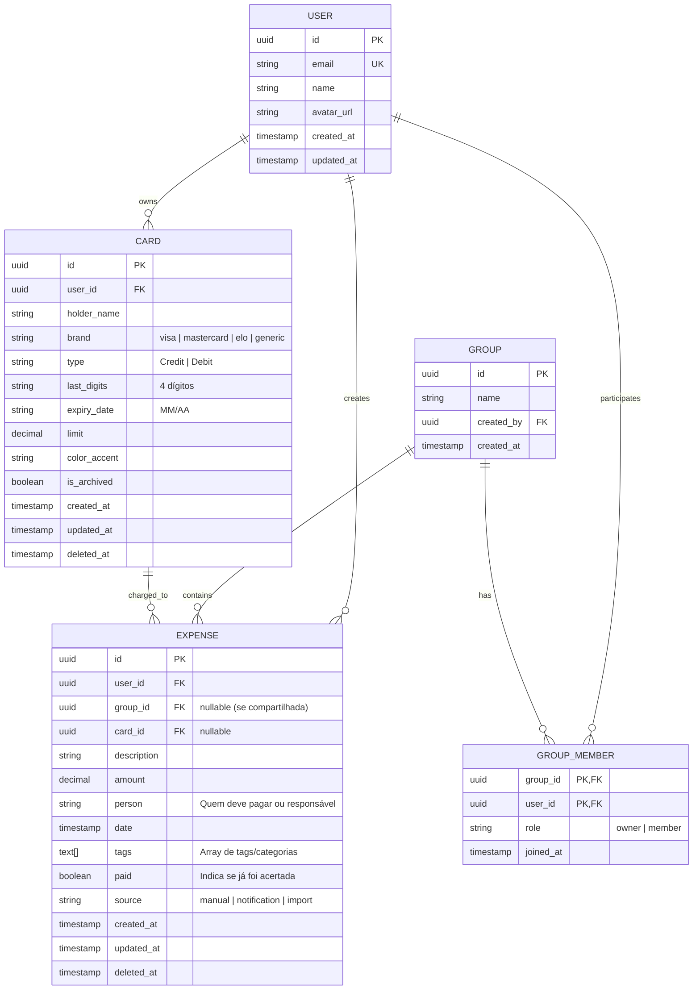

# Cashya - Guia e Especificação Técnica para Backend (API & Arquitetura)

> **Documento direcionado para a equipe de Engenharia de Backend / Arquitetura de Dados.**  
> Este guia estabelece o norte técnico, contratos de dados, regras de negócio e a proposta de transição do Cashya do modelo atual (*Local-First / Offline*) para uma arquitetura com **sincronização em nuvem e backend compartilhado**.

---

## 1. Visão Geral do Cashya

O **Cashya** é um aplicativo mobile financeiro focado em rastreamento de despesas pessoais e compartilhadas (quem deve a quem, status de pagamento por despesa, categorização por tags e vínculo a cartões de crédito/débito), seguindo a estética visual **Nothing OS** (minimalista, dark OLED, tipografia dot-matrix e acentos vermelhos).

### Estado Atual (Mobile App)
- **Framework**: React Native com Expo (SDK 57) e TypeScript.
- **Persistência**: `AsyncStorage` local (`@cashya:expenses`, `@cashya:cards`).
- **Autenticação**: Inexistente no momento (zero-friction, sem login).
- **Importação/Exportação**: Backup manual via arquivo JSON (`BackupData`).

### Objetivo da Integração com Backend
1. **Autenticação & Multi-tenancy**: Permitir contas de usuário para sincronizar dados entre múltiplos dispositivos.
2. **Despesas Compartilhadas / Grupos**: Permitir que duas ou mais pessoas vejam e gerenciem despesas em comum (ex: casais, repúblicas, viagens).
3. **Sincronização Bidirecional Offline-First**: O app deve continuar funcionando offline e sincronizar mudanças (CRDT / Last-Write-Wins / delta sync) quando restabelecer conexão.
4. **Segurança & Criptografia**: Respeitar a privacidade dos dados financeiros dos usuários.

---

## 2. Modelagem de Domínio & Entidades (Banco de Dados)

Abaixo estão os esquemas relacionais recomendados com base nos tipos já consumidos no frontend (`types/index.ts`).

### Diagrama Entidade-Relacionamento (ERD Sugerido)



---

## 3. Contratos de Dados (TypeScript Interfaces)

O backend deve expor respostas estruturadas e previsíveis. Abaixo estão os contratos canônicos derivados do frontend:

### 3.1. `CreditCard`
```typescript
type CardBrand = 'visa' | 'mastercard' | 'elo' | 'generic';
type CardType = 'Credit' | 'Debit';

interface CreditCardDTO {
  id: string;              // UUID
  holderName: string;      // Ex: "MAIN WALLET", "NUBANK"
  brand: CardBrand;
  type: CardType;
  lastDigits: string;      // Ex: "4321" (máximo 4 caracteres)
  expiryDate: string;      // Formato: "MM/YY"
  limit: number;           // Ex: 5000.00
  colorAccent?: string;    // Hex code, default: "#ff453a"
  createdAt?: string;      // ISO 8601
  updatedAt?: string;      // ISO 8601
}
```

### 3.2. `Expense`
```typescript
interface ExpenseDTO {
  id: string;                         // UUID gerado pelo cliente ou backend
  description: string;                // Nome/descrição da despesa
  amount: number;                     // Valor monetário float/decimal positivo (> 0)
  person: string;                     // Responsável pelo pagamento / divisão
  date: string;                       // ISO 8601 string (ex: "2026-09-21T16:00:00.000Z")
  tags: string[];                     // Categorias, ex: ["Mercado", "Casa", "Lazer"]
  paid: boolean;                      // true = liquidada, false = pendente
  source?: 'manual' | 'notification' | 'import';
  cardId?: string | null;             // UUID do cartão associado (opcional)
  createdAt?: string;                 // ISO 8601
  updatedAt?: string;                 // ISO 8601
}
```

### 3.3. `BackupData` (Formato de Intercâmbio JSON)
```typescript
interface BackupDataPayload {
  version: string;                    // Ex: "1.0.0"
  exportedAt: string;                 // ISO 8601
  cards: CreditCardDTO[];
  expenses: {
    id: string;
    description: string;
    amount: number;
    person: string;
    date: string;                     // ISO 8601
    tags: string[];
    paid: boolean;
    source?: 'manual' | 'notification' | 'import';
    cardId?: string;
  }[];
}
```

---

## 4. Especificação de Endpoints RESTful (API v1)

Todas as rotas protegidas devem receber o token JWT via cabeçalho:  
`Authorization: Bearer <token>`

### 4.1. Autenticação & Usuários
| Método | Endpoint | Descrição |
| :--- | :--- | :--- |
| `POST` | `/api/v1/auth/register` | Criação de conta (Email + Senha ou OAuth). |
| `POST` | `/api/v1/auth/login` | Autenticação retornando `accessToken` e `refreshToken`. |
| `POST` | `/api/v1/auth/refresh` | Renovação de token de acesso expirado. |
| `GET` | `/api/v1/users/me` | Retorna perfil do usuário logado. |

---

### 4.2. Despesas (`/api/v1/expenses`)

#### `GET /api/v1/expenses`
Lista despesas do usuário com suporte a filtros e paginação.
- **Query Params**:
  - `page`: int (padrão: 1)
  - `limit`: int (padrão: 50)
  - `searchText`: string (busca parcial em `description`)
  - `person`: string (filtrar por pessoa responsável)
  - `tag`: string (filtrar por tag)
  - `status`: `'all' | 'pending' | 'paid'`
  - `cardId`: UUID (opcional)
  - `startDate`: ISO Date
  - `endDate`: ISO Date
  - `since`: ISO Date (para delta sync offline)

#### `POST /api/v1/expenses`
Cria uma nova despesa.
- **Body**:
  ```json
  {
    "id": "opcional-uuid-client-generated",
    "description": "Jantar Outback",
    "amount": 185.50,
    "person": "Carlos",
    "date": "2026-09-21T20:30:00Z",
    "tags": ["Alimentação", "Lazer"],
    "paid": false,
    "cardId": "4a7f-...",
    "source": "manual"
  }
  ```

#### `PUT / PATCH /api/v1/expenses/:id`
Atualiza dados parciais ou totais da despesa.

#### `PATCH /api/v1/expenses/:id/toggle-paid`
Alterna rapidamente o status de pagamento (`paid: true/false`). Retorna o objeto atualizado.

#### `DELETE /api/v1/expenses/:id`
Exclusão lógica (*soft delete*) da despesa.

---

### 4.3. Cartões (`/api/v1/cards`)

| Método | Endpoint | Descrição |
| :--- | :--- | :--- |
| `GET` | `/api/v1/cards` | Lista todos os cartões cadastrados do usuário. |
| `POST` | `/api/v1/cards` | Cadastra um novo cartão. |
| `PUT / PATCH` | `/api/v1/cards/:id` | Edita dados de um cartão existente (limite, apelido, etc). |
| `DELETE` | `/api/v1/cards/:id` | Desativa ou remove um cartão (atenção a despesas associadas). |

---

### 4.4. Sincronização & Migração de Dados

#### `POST /api/v1/sync/batch`
Endpoint crucial para o suporte offline-first. Envia lotes de mutações feitas localmente pelo app enquanto esteve offline.
- **Body**:
  ```json
  {
    "lastSyncTimestamp": "2026-09-20T10:00:00Z",
    "mutations": [
      { "type": "CREATE_EXPENSE", "data": { ... } },
      { "type": "UPDATE_EXPENSE", "id": "...", "data": { ... } },
      { "type": "DELETE_EXPENSE", "id": "..." }
    ]
  }
  ```
- **Response**:
  ```json
  {
    "syncedAt": "2026-09-21T13:30:00Z",
    "serverChanges": {
      "expenses": [...],
      "cards": [...]
    },
    "conflicts": []
  }
  ```

#### `POST /api/v1/sync/import-backup`
Permite enviar o arquivo JSON de backup já gerado pelo app mobile atual para popular a conta do usuário na nuvem de uma só vez.

---

## 5. Regras de Negócio & Validações Essenciais

1. **Validação Monetária**:
   - `amount` deve ser estritamente maior que zero (`amount > 0`).
   - Recomenda-se armazenar no banco em centavos (`integer`) ou tipo `numeric(12, 2)` para evitar problemas de arredondamento de ponto flutuante.
2. **Identificadores (UUIDs)**:
   - Suportar UUIDv4 gerado pelo cliente (permite criar itens offline antes de sincronizar com o banco).
3. **Resolução de Conflitos**:
   - Adotar estratégia de **Last-Write-Wins (LWW)** baseado em `updatedAt` / timestamps do servidor para versões iniciais.
4. **Soft Delete**:
   - Despesas e cartões deletados devem usar coluna `deleted_at` para que a deleção seja propagada corretamente para outros dispositivos sincronizados.
5. **Integridade de Cartões**:
   - Se um cartão for removido, as despesas vinculadas a ele não devem ser deletadas em cascata; o campo `card_id` na despesa deve virar `NULL` (ou o cartão deve ser apenas arquivado).

---

## 6. Sugestão de Stack Tecnológica para o Backend

- **Runtime / Framework**: Node.js com NestJS / Fastify, Go ou Python (FastAPI).
- **Banco de Dados**: PostgreSQL (suporta nativamente arrays para `tags`, tipos `numeric` para moedas e JSONB se necessário).
- **ORM**: Prisma ou Drizzle ORM (TypeScript end-to-end com tipagem estrita espelhando o mobile).
- **Validação de Schema**: Zod (já compatível com o ecossistema TS).
- **Deploy**: Docker / AWS / Railway / Supabase.
