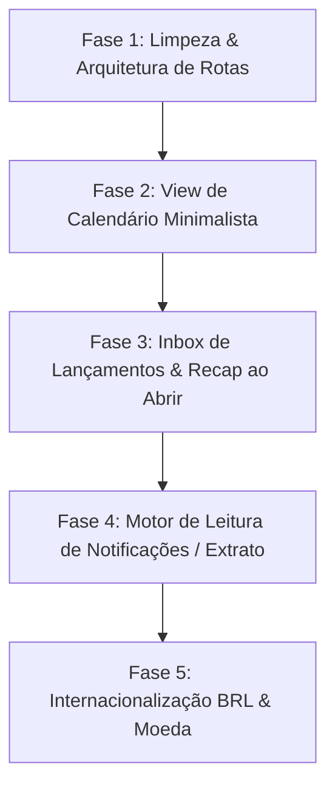

# Análise Estrutural & Plano de Evolução do Cashya

## 1. Diagnóstico da Estrutura Atual

O **Cashya** possui uma base simples, direta e muito bem desenhada visualmente (inspirada no Nothing OS com fontes dot-matrix `Ndot57` e tema escuro minimalista). No entanto, conforme o app cresce, identificamos pontos estruturais que precisam de maturidade:

1. **Roteamento vs. Modais**:
   - O projeto usa Expo Router, mas todas as telas secundárias (`AddExpenseScreen`, `EditExpenseScreen`, `StatisticsScreen`) estão sendo abertas como `<Modal>` React Native dentro de [HomeScreen.tsx](file:///home/yanj/Projetos/Cashya/components/screens/HomeScreen.tsx), sobrecarregando o arquivo principal (+500 linhas).
   - O diretório `app/` possui rotas do template inicial (como `app/(tabs)/explore.tsx` e `app/modal.tsx`) que não refletem o app real.
2. **Persistência de Dados**:
   - Baseada puramente em `@react-native-async-storage/async-storage` salvando um array único em `@cashya:expenses`.
   - Para suportar centenas de movimentações, busca por data, filtros rápidos e notificações em segundo plano, um banco local estruturado (como **Expo SQLite** / **OP-SQLite**) ou uma camada de repositório organizada trará muito mais robustez e velocidade.
3. **Internacionalização e Moeda**:
   - Há mistura de strings em inglês nos componentes com cifrão fixo (`$`), embora a documentação e o público-alvo sejam em português (BRL `R$`).

---

## 2. As Três Novas Funcionalidades Solicitadas

### Feature A: View de Calendário (Calendar Expense View)
- **Objetivo**: Permitir que o usuário visualize o mês em formato de grade (ou fita semanal), com indicadores visuais dot-matrix/pontos luminosos em cada dia que possuir despesas, exibindo o total do dia e a lista rápida ao selecionar a data.
- **Abordagem Técnica**:
  - Implementar um componente de calendário customizado 100% no design system do Cashya (dot-matrix, cores `COLORS.primary`, fundo escuro), sem bibliotecas externas pesadas que quebrem a identidade Nothing OS.
  - Alternância suave no topo da tela inicial ou via aba dedicada entre a lista linear atual e a visualização de calendário mensal.

### Feature B: Catcher de Movimentações Bancárias (Local-First)
- **Desafio no ecossistema Mobile**:
  - **Android**: Permite escutar notificações de outros apps (Push/Bank alerts) através do serviço nativo `NotificationListenerService`. Requer um módulo nativo (`Expo Config Plugin` ou Native Module) e permissão explícita do usuário em "Acesso a Notificações".
  - **iOS**: A Apple proíbe terminantemente por sandbox que um aplicativo leia notificações de terceiros. A alternativa elegante e local-first no iOS são **Atalhos da Siri (Siri Shortcuts)** que disparam um Deep Link para o Cashya quando o banco envia notificação, ou importação rápida de extrato (OFX/CSV) / Share Sheet.
- **Arquitetura Proposta (100% Local-First)**:
  1. **Notification Parser Engine (Local)**:
     - Regras locais de Regex pré-configuradas para os principais bancos brasileiros (Nubank, Inter, Itaú, C6, Bradesco, etc.).
     - Exemplo: `"Compra de R$ 35,00 no Débito em Padaria do Zé" -> { amount: 35.00, description: "Padaria do Zé", date: now, tags: ["Alimentação"] }`.
  2. **Android Native Module / Expo Module (`expo-notification-listener`)**:
     - Quando o usuário concede permissão, o serviço intercepta as notificações bancárias, roda o regex localmente e salva em uma fila de movimentações não revisadas (`pending_inbox`).
  3. **Fallback Universal (Share Sheet & Clipboard Listener / Siri Shortcut)**:
     - Opção de copiar o texto do comprovante/SMS ou compartilhar com o Cashya, gerando o cadastro imediato sem internet.

### Feature C: Recap Inteligente ao Abrir o App
- **Objetivo**: Ao abrir o aplicativo, se novas movimentações foram capturadas ou adicionadas desde o último fechamento, o app exibe uma folha de estilo retro/resumo com visual Nothing OS.
- **Fluxo do Recap**:
  1. O app guarda no storage a chave `last_opened_timestamp` e o estado das transações.
  2. Na inicialização (`useEffect` no Root ou Hook dedicado `useAppRecap`):
     - Compara as transações inseridas/capturadas após o último fechamento.
     - Se houver transações (ex: capturadas via catcher ou pendentes de revisão), abre um BottomSheet / Card de destaque estilo "Radar Financeiro":
       - *"3 novas despesas detectadas enquanto você esteve fora (R$ 142,50 total)."*
       - Botão rápido para confirmar/categorizar cada uma ou descartar.

---

## 3. To-Do Geral de Evolução & Refatoração

### 📋 Checklist de Tarefas Propostas

- [ ] **Fase 1: Refatoração Estrutural e Navegação**
  - [ ] Limpar arquivos template órfãos (`app/(tabs)/explore.tsx`, `modal.tsx`).
  - [ ] Modularizar a navegação: transformar as telas hoje em modais (`AddExpenseScreen`, `StatisticsScreen`) em rotas reais do Expo Router ou stack organizada.
  - [ ] Criar pasta `services/` e isolar a camada de armazenamento/repositório (`storage.service.ts`).

- [ ] **Fase 2: Implementação da View de Calendário**
  - [ ] Criar componente `CalendarView` respeitando o design retrô dot-matrix (`Ndot57`).
  - [ ] Adicionar alternador de visão (Lista ↔ Calendário) no [HomeScreen.tsx](file:///home/yanj/Projetos/Cashya/components/screens/HomeScreen.tsx).
  - [ ] Marcar dias com pontuações (dots vermelhos para despesas pendentes, verdes para pagas).
  - [ ] Painel inferior expansível ao selecionar um dia específico.

- [ ] **Fase 3: Sistema de Recap & "Inbox" de Movimentações**
  - [ ] Criar estado `pendingInbox` no [ExpensesContext.tsx](file:///home/yanj/Projetos/Cashya/contexts/ExpensesContext.tsx) para transações ainda não conciliadas.
  - [ ] Criar hook `useAppRecap` para checar `lastOpenedAt` e transações novas.
  - [ ] Criar componente modal/bottomsheet `RecapModal` com animação dot-matrix exibindo saldo de novas movimentações.

- [ ] **Fase 4: Catcher de Notificações Bancárias (Local-First)**
  - [ ] Implementar o motor de parsing de texto/notificações (`BankNotificationParser.ts`) com suporte a regex para bancos populares.
  - [ ] Criar serviço nativo Android para escuta de notificações usando biblioteca compatível (ou Expo Config Plugin de `NotificationListenerService`).
  - [ ] Criar modal de revisão de despesas detectadas para o usuário validar antes de efetivar.

- [ ] **Fase 5: Moeda e Formatação BRL**
  - [ ] Adicionar suporte configurável de moeda (padrão `BRL - R$`).
  - [ ] Formatação de datas em formato local brasileiro (DD/MM/YYYY).

---

## 4. Próximos Passos & Decisões do Usuário

Por favor, analise a proposta e os pontos de decisão:
1. **Calendário**: Você prefere que o Calendário seja um botão para alternar a tela inicial (Lista vs Calendário) ou uma aba nova na barra de navegação?
2. **Catcher de Notificação**: No Android, você gostaria de já configurar o suporte nativo ao Notification Listener (gera APK/build de desenvolvimento EAS)? No iOS, concorda em adotar atalhos rápidos/clipboard/deep link como alternativa?
3. **Ordem de Implementação**: Podemos começar pela **View de Calendário** ou pela **Refatoração + Recap**?
